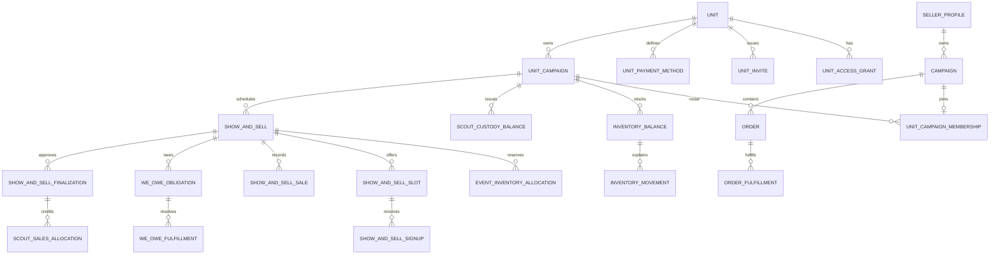

# Show & Sell and inventory data model

**Status:** Proposed technical model derived from confirmed requirements  
**Last updated:** 2026-10-30  
**Requirements:** [Show & Sell and inventory specification](SHOW_AND_SELL_INVENTORY_SPECIFICATION.md)  
**Workflow oracles:** [Show & Sell smoke test plan](SHOW_AND_SELL_SMOKE_TEST_PLAN.md)  
**GraphQL resolver contracts:** [Show & Sell GraphQL API](SHOW_AND_SELL_GRAPHQL_API.md)  
**Reporting architecture:** [Browser-only reporting and document generation](BROWSER_REPORTING_ARCHITECTURE.md)  
**Transaction sequences:** [Show & Sell sequence diagrams](SHOW_AND_SELL_SEQUENCE_DIAGRAMS.md)

## 1. Purpose and modeling decisions

This document defines the new logical records, their fields and invariants, a recommended DynamoDB layout, and the transaction boundaries needed to preserve the confirmed behavior.

The principal decisions are:

1. **Unit is the new ownership root.** Unit settings and payment methods belong to a Unit; Unit Campaigns reference a stable `unitId`.
2. **Unit Campaigns remain independent.** Inventory, events, custody, Council on-order quantities, and obligations never move automatically between them.
3. **Existing individual sales remain Orders.** Show & Sell pooled sales use a new `ShowAndSellSale` model because they do not have one seller/`profileId` at entry time.
4. **Quantities are integers and money is integer cents.** One inventory unit equals one sale unit. No case conversion or repeating-decimal money is stored.
5. **Balances and immutable movements coexist.** Balances answer current-state queries; movements explain every change and provide the audit trail.
6. **Pending Scout allocations are calculated previews.** Only finalized allocation versions are persisted. Reopening suspends the approved version rather than rewriting history.
7. **Base-table consistent reads and versions protect invariants.** Eventually consistent GSIs support discovery/reporting but are not authoritative for access, stock, capacity, or conflict checks.
8. **No unrequested subsystems are introduced.** There are no notification outboxes, offline queues, delivery assignments, due dates, multiple-tender records, reschedule records, or cross-campaign product mappings.

## 2. Existing models reused or extended

| Existing model | Use in the feature | Required extension |
| --- | --- | --- |
| `Account` | Identity for Unit access, actors, and audit | None. Global `isAdmin` does not imply Unit access. |
| `SellerProfile` | Scout identity and individual-sale owner | None. Unit membership is not inferred from profile fields. |
| `Campaign` | Scout's individual sales container | Add nullable `unitId` and `unitCampaignId` after joining. Keep them after membership removal for history. |
| `Catalog` / embedded `Product` | Product identity and current prices for a Unit Campaign | None. Products continue to use stable `productId`; sales capture snapshots. |
| `Order` / embedded `LineItem` | Individual Scout sales and Council demand | Add originating `unitId`/`unitCampaignId` and `fulfillmentVersion` to the Order; add `lineItemId` and integer `fulfilledQuantity` to each line item. New pre-production rows use these natively. |
| `SharedCampaign` | Existing campaign-template behavior | Do not repurpose it as the Unit-owned sales season. Use the new `UnitCampaign` model. |

`Campaign.unitCampaignId` is a historical join link. Eligibility for a new signup comes from the authoritative `UnitCampaignMembership.status`, not from the Campaign field alone.

## 3. Common types and enumerations

### 3.1 Common scalar types

| Type | Representation |
| --- | --- |
| IDs | String UUID/ULID; also embedded in table keys where specified |
| `Quantity` | Non-negative integer except signed movement deltas, which are serialized separately from balances |
| `MoneyCents` | Signed integer only for adjustments/discrepancies; otherwise non-negative integer cents |
| `Minutes` | Positive integer for confirmed work; zero for unconfirmed signup |
| Timestamps | ISO-8601 UTC strings; Unit timezone is display/ICS metadata only |
| `Version` | Monotonically increasing integer used for optimistic concurrency |
| Reason/text | Trimmed strings with implementation-level length limits; snapshots preserve the original text |

### 3.2 Enumerations

| Enumeration | Values |
| --- | --- |
| `UnitRole` | `UNIT_ADMIN` only. “Unit Kernel” is a display synonym, never a second stored role. |
| `MembershipStatus` | `ACTIVE`, `REMOVED` |
| `SplitMethod` | `EQUAL`, `TIME_WORKED` |
| `CouncilNeedBasis` | `PHYSICAL_STOCK`, `AFTER_ASSIGNMENTS` |
| `ShowAndSellStatus` | `SCHEDULED`, `ACTIVE`, `ENDED`, `FINALIZED`, `REOPENED`, `CANCELLED` |
| `AllocationStatus` | `OPEN`, `RELEASED`, `CANCELLED` |
| `SignupStatus` | `ACTIVE`, `CANCELLED` |
| `SaleStatus` | `ACTIVE`, `VOIDED` |
| `WeOweStatus` | `OPEN`, `CLOSED` |
| `WeOweCloseReason` | `FULFILLED`, `CANCELLED` |
| `FinalizationStatus` | `APPROVED`, `SUSPENDED`, `SUPERSEDED` |
| `AllocationCreditStatus` | `APPROVED`, `SUSPENDED`, `SUPERSEDED` |
| `FulfillmentSource` | `KERNEL_STOCK`, `SCOUT_CUSTODY`, `EXTERNAL_COUNCIL` |
| `FulfillmentRecordType` | `FULFILL`, `REVERSAL` |
| `BuiltInPaymentMethod` | `Cash`, `Check`, `Other`; these exact snapshots are not renamed |
| `InventoryMovementType` | Values listed in Section 5.8 |

`ACTIVE`/`ENDED` event states describe operational workflow. `startAt` and `endAt` remain immutable and determine whether cancellation is legal; a worker may reconcile state transitions, but clients must not be able to move an event backward to bypass the rules.

## 4. Entity relationships



## 5. Logical models

### 5.1 `Unit`

| Field | Type | Notes |
| --- | --- | --- |
| `unitId` | ID | Stable identity; never derived from metadata |
| `unitType` | string | Required, for example Pack or Troop |
| `unitNumber` | integer/string display value | Required; not globally unique |
| `city` | string | Required geographic discriminator |
| `state` | string | Required geographic discriminator |
| `displayName` | string | Optional input; generated from metadata when omitted |
| `metadataKey` | string | Normalized `unitType#unitNumber#city#state` for duplicate lookup only |
| `timezone` | string | Required for display/ICS; initial default may be selected by creator |
| `splitDefault` | `SplitMethod` | Unit-wide default for new events |
| `councilNeedBasis` | `CouncilNeedBasis` | Primary report presentation; both values remain available |
| `adminCount` | integer | Authoritative count of access grants; always at least 1 |
| `version` | Version | Protects grant/settings mutations |
| `createdAt` / `updatedAt` | timestamp | Audit |
| `createdByAccountId` | ID | Creator and initial Unit Admin |

Invariants:

- `adminCount >= 1` while the Unit exists.
- `metadataKey` is not unique and never grants access.
- `Unit Admin` and `Unit Kernel` resolve to the same grant lookup.

### 5.2 `UnitAccessGrant`

| Field | Type | Notes |
| --- | --- | --- |
| `unitId` | ID | Owning Unit |
| `accountId` | ID | Granted Account |
| `role` | `UNIT_ADMIN` | Only stored role |
| `createdByAccountId` | ID | Inviter/creator |
| `createdAt` | timestamp | Grant start; no automatic expiry |

Invariants:

- Unique `(unitId, accountId)`.
- Revoke requires a transaction proving `adminCount > 1`, then decrements it.
- Redeeming an already-held grant does not increment `adminCount` or consume another invite incorrectly.

### 5.3 `UnitInvite`

| Field | Type | Notes |
| --- | --- | --- |
| `inviteCode` | string | 16-character bearer credential and unique lookup key |
| `unitId` | ID | Unit to join |
| `createdByAccountId` | ID | Unit Admin who generated it |
| `createdAt` | timestamp | Creation |
| `expiresAt` | timestamp | Maximum 14 days; application-side expiry validation |
| `expiresAtEpoch` | number | Epoch-seconds DynamoDB TTL attribute for eventual physical deletion |

Invariants:

- Single-use; redemption conditionally deletes the invite while creating the grant.
- Expired/deleted/already-used codes are indistinguishable to redeemers.
- No email address or permission list is stored.

### 5.4 `UnitPaymentMethod`

Built-in Cash, Check, and Other are computed and are not stored as custom methods.

| Field | Type | Notes |
| --- | --- | --- |
| `paymentMethodId` | ID | Stable within the custom method's history |
| `unitId` | ID | Owning Unit |
| `displayName` | string | Current name shown to users |
| `normalizedName` | string | Case-folded key; unique per Unit |
| `qrCodeS3Key` | string/null | Optional shared QR object |
| `isActive` | boolean | Inactive methods are unavailable for new sales but preserved for history |
| `createdAt` / `updatedAt` | timestamp | Audit |
| `createdByAccountId` / `updatedByAccountId` | ID | Audit |
| `version` | Version | Optimistic concurrency for method/QR mutations |

A rename is a key-changing custom-method update. Historical `ShowAndSellSale.paymentMethodSnapshot` is never updated. Custom normalized names `cash`, `check`, and `other` are reserved case-insensitively, so a custom method can never masquerade as a built-in method.

### 5.5 `UnitCampaign`

| Field | Type | Notes |
| --- | --- | --- |
| `unitCampaignId` | ID | Stable campaign identity |
| `unitId` | ID | Parent Unit |
| `campaignName` | string | Sales-season name |
| `campaignYear` | integer | Sales year |
| `catalogId` | ID | Existing catalog used by this campaign |
| `joinCode` | string | Reusable campaign-join credential; unique pointer item enforces uniqueness |
| `isActive` | boolean | Deactivation has no balance side effects |
| `version` | Version | Optimistic concurrency for metadata/deactivation updates |
| `createdAt` / `updatedAt` | timestamp | Audit |
| `createdByAccountId` / `updatedByAccountId` | ID | Unit Admin actors |

A separate join-code pointer maps `joinCode -> unitCampaignId` and is created/deleted in the same transaction as the campaign. Join-code lookup uses a consistent base-table read followed by a consistent campaign read. `catalogId` is immutable after creation so inventory, Order origin, and event product identities cannot be moved implicitly between catalogs; create a new independent Unit Campaign for a different catalog.

### 5.6 `UnitCampaignMembership`

| Field | Type | Notes |
| --- | --- | --- |
| `unitCampaignId` | ID | Joined Unit Campaign |
| `unitId` | ID | Denormalized tenancy check |
| `campaignId` | ID | Existing Scout Campaign |
| `profileId` | ID | Scout identity |
| `status` | `MembershipStatus` | `ACTIVE` allows new signups; `REMOVED` blocks them |
| `joinedByAccountId` | ID | Account that redeemed the join code |
| `joinedAt` | timestamp | Current join time |
| `removedByAccountId` / `removedAt` | ID/timestamp/null | Removal audit |
| `version` | Version | Membership mutations/rejoin |

Invariants:

- Exactly one membership identity per `(unitCampaignId, profileId)`; its `campaignId` is immutable. This prevents two Scout Campaigns for the same Scout from competing for one event-credit identity.
- A Scout Campaign has at most one ACTIVE membership at a time. Join creation/update conditions on that absence of active membership, not on the historical `Campaign.unitCampaignId` value. Joining a different Unit Campaign updates the Campaign's latest link; removal retains it without blocking a later join. Immutable Order-origin fields preserve prior demand/inventory scope.
- Removal sets status/timestamps only. It does not delete signups, work, allocations, or history.
- Rejoin may reactivate only the same `(unitCampaignId, profileId, campaignId)` record and increments versions; historical participation remains intact. Joining a different Unit Campaign does not rewrite old Orders or their fulfillment scope.

`ScoutCampaignMembershipGuard` is one `{ campaignId, profileId, activeUnitCampaignId, membershipVersion, updatedAt }` record per Scout Campaign. It is the authoritative cross-campaign join lock; `activeUnitCampaignId` is null when no membership is active and is not inferred from the historical Campaign link.

### 5.7 `InventoryBalance`

One per `(unitCampaignId, productId)`.

| Field | Type | Notes |
| --- | --- | --- |
| `unitCampaignId` | ID | Campaign scope |
| `productId` | ID | Catalog product |
| `kernelPhysicalQty` | Quantity | Central physical stock, including assigned and We Owe-reserved stock |
| `soldInPossessionQty` | Quantity | Portion reserved for We Owe |
| `councilOnOrderQty` | Quantity | Separate expected Council supply; never subtracted automatically |
| `version` | Version | Serializes every stock/allocation write for this product |
| `createdAt` / `updatedAt` | timestamp | Audit |

Invariants and derived values:

```text
kernelPhysicalQty >= soldInPossessionQty >= 0
councilOnOrderQty >= 0
sellableKernelQty = kernelPhysicalQty - soldInPossessionQty
```

Assigned/unassigned quantities are derived from open `EventInventoryAllocation` records, not stored as independently mutable fields.

### 5.8 `InventoryMovement`

Append-only product-level audit record.

| Field | Type | Notes |
| --- | --- | --- |
| `movementId` | ID | Unique movement |
| `unitCampaignId` / `productId` | ID | Movement scope |
| `movementType` | enum | See values below |
| `kernelPhysicalDelta` | integer | Signed change to central physical stock; zero when not applicable |
| `soldPossessionDelta` | integer | Signed change to We Owe-reserved central stock |
| `withScoutDelta` | integer | Signed change to one Scout's custody |
| `assignedDelta` | integer | Signed explanation of allocation change; allocations remain authoritative |
| `councilOnOrderDelta` | integer | Signed change to separate on-order balance |
| `profileId` | ID/null | Scout for custody/individual fulfillment |
| `showAndSellId` | ID/null | Related event |
| `saleId` / `orderId` / `weOweId` | ID/null | Source links when applicable |
| `fulfillmentId` / `finalizationId` | ID/null | Source links when applicable |
| `reason` | string/null | Required for manual adjustments/reconciliation |
| `actorAccountId` | ID | Who performed the action |
| `occurredAt` | timestamp | Business event time |
| `inventoryVersion` | Version | Resulting `InventoryBalance.version` |
| `idempotencyKey` | string | Prevents duplicate application |

`InventoryMovementType` values:

- `RECEIPT`
- `STOCK_ADJUSTMENT`
- `COUNCIL_ON_ORDER_ADJUST`
- `EVENT_ASSIGN`
- `EVENT_MANUAL_REDUCE`
- `EVENT_AUTO_REDUCE`
- `EVENT_IMMEDIATE_SALE`
- `EVENT_RELEASE`
- `EVENT_RETURN_RECONCILE`
- `EVENT_RE_FINALIZE_ADJUST`
- `SCOUT_ISSUE`
- `SCOUT_SALE_CONSUME`
- `SCOUT_RETURN`
- `INDIVIDUAL_FULFILL`
- `WE_OWE_RESERVE`
- `WE_OWE_RELEASE`
- `WE_OWE_FULFILL`
- `REVERSAL`

Movement rows are never edited to “fix” history. Corrections create new linked movements.

### 5.9 `ScoutCustodyBalance`

One per `(unitCampaignId, productId, profileId)`.

| Field | Type | Notes |
| --- | --- | --- |
| `unitCampaignId` / `productId` / `profileId` | ID | Custody scope |
| `campaignId` | ID | Scout Campaign used for individual sales |
| `withScoutQty` | Quantity | Unsold unit-owned stock with the Scout |
| `version` | Version | Serializes issue/sale/return for this custody row |
| `createdAt` / `updatedAt` | timestamp | Audit |

Invariants:

- `withScoutQty >= 0`.
- Issue decrements sellable Kernel stock and increments custody without changing total unit-owned stock.
- Door-to-door sale consumption decrements custody only; return increments Kernel stock and decrements custody.

### 5.10 `ShowAndSell`

| Field | Type | Notes |
| --- | --- | --- |
| `showAndSellId` | ID | Stable event identity |
| `unitId` / `unitCampaignId` | ID | Tenancy and campaign scope |
| `locationName` | string | Required short name |
| `address` | string/null | Optional address |
| `startAt` / `endAt` | timestamp | Immutable after creation; cancel/recreate instead of rescheduling |
| `status` | `ShowAndSellStatus` | Workflow state |
| `splitMethod` | `SplitMethod` | Snapshot of Unit default or explicit event override |
| `weOweEnabled` | boolean | Defaults false |
| `productIds` | ID set/list | Products ever allocated/sold; used to find authoritative inventory allocation records |
| `roundingDraftByProfileId` | map<string, integer> | Kernel's draft assignment of leftover cents; not approved credit |
| `approvedFinalizationId` | ID/null | Approved credit version; null while pending/reopened |
| `latestFinalizationId` | ID/null | Most recent version for history |
| `version` | Version | Event mutations/finalization |
| `createdByAccountId` / `createdAt` | ID/timestamp | Audit |
| `updatedByAccountId` / `updatedAt` | ID/timestamp | Audit |
| `cancelledByAccountId` / `cancelledAt` | ID/timestamp/null | Pre-start cancellation audit |
| `cancellationReason` | string/null | Required reason supplied at cancellation |

Invariants:

- `endAt > startAt`; times never change after creation.
- `productIds` contains every product ever allocated or sold at the event, with no event-wide product-count cap. Products come from the Unit Campaign's catalog/inventory.
- Cancellation is legal only for a Unit Admin before `startAt`.
- `FINALIZED` requires `approvedFinalizationId`; `REOPENED` requires it to be null.
- No per-event payment-method allowlist is stored.

### 5.11 `EventInventoryAllocation`

One per `(unitCampaignId, productId, showAndSellId)`, stored with the authoritative product inventory records.

| Field | Type | Notes |
| --- | --- | --- |
| `unitCampaignId` / `productId` / `showAndSellId` | ID | Allocation scope |
| `startAt` / `endAt` | timestamp | Denormalized immutable event interval for authoritative overlap checks |
| `status` | `AllocationStatus` | Open allocations count as assigned |
| `allocatedQty` | Quantity | Current allocation after manual/automatic reductions |
| `soldQty` | Quantity | Immediate-handoff units sold |
| `releasedQty` | Quantity | Allocation released on cancellation/finalization |
| `remainingQty` | Quantity | Current unsold/unreleased allocation |
| `version` | Version | Allocation mutations |
| `createdAt` / `updatedAt` | timestamp | Audit |

Invariants:

```text
allocatedQty >= soldQty >= 0
releasedQty >= 0
remainingQty = allocatedQty - soldQty - releasedQty
remainingQty >= 0
```

`expectedReturnQty` before finalization is `remainingQty`. Actual returned quantity and any stock-only reconciliation are stored on the finalization record. We Owe quantities do not decrement this allocation.

### 5.12 `ShowAndSellSlot`

| Field | Type | Notes |
| --- | --- | --- |
| `showAndSellId` / `slotId` | ID | Slot scope |
| `label` | string/null | Optional display label |
| `startAt` / `endAt` | timestamp | Arbitrary duration within event interval |
| `capacity` | positive integer | Maximum active signups |
| `activeSignupCount` | integer | Transactionally maintained counter |
| `version` | Version | Serializes signup/capacity changes |
| `createdAt` / `updatedAt` | timestamp | Audit |

Invariants:

- `event.startAt <= slot.startAt < slot.endAt <= event.endAt`.
- `0 <= activeSignupCount <= capacity`.
- Reducing capacity below active signups is rejected or requires explicit signup removal first.

### 5.13 `ShowAndSellSignup` and `ScoutCommitment`

`ShowAndSellSignup` is the event-aggregate record and also holds confirmed work.

| Field | Type | Notes |
| --- | --- | --- |
| `showAndSellId` / `slotId` / `profileId` | ID | Unique Scout-per-slot identity |
| `unitCampaignId` / `campaignId` | ID | Roster and credit scope |
| `status` | `SignupStatus` | Active or cancelled |
| `actualMinutes` | Minutes | Zero until Kernel confirms work |
| `confirmedByAccountId` / `confirmedAt` | ID/timestamp/null | Work confirmation audit |
| `signedUpByAccountId` | ID | Parent/WRITE Account or Unit Admin |
| `createdAt` / `updatedAt` | timestamp | Audit |
| `version` | Version | Signup/work updates |

`ScoutCommitment` is a denormalized, transactionally maintained projection used for authoritative time-conflict queries across **all** Unit Campaigns:

| Field | Type | Notes |
| --- | --- | --- |
| `profileId` | ID | Consistent-query partition for every commitment held by the Scout |
| `unitCampaignId` | ID | Source campaign; does not partition the conflict check |
| `commitmentId` | ID | Same identity as the signup |
| `showAndSellId` / `slotId` | ID | Source |
| `startAt` / `endAt` | timestamp | Conflict interval |
| `status` | `ACTIVE`/`CANCELLED` | Only active commitments block new signups |
| `version` | Version | Matches source signup update |

`ScoutCommitmentGuard` is one small `{ profileId, commitmentVersion, updatedAt }` record per Scout. Every signup/cancellation increments it, serializing commitment changes across all of the Scout's memberships.

Invariants:

- At most one active signup per `(slotId, profileId)`.
- No two active commitments for one Scout may overlap, including commitments in different Unit Campaigns. Adjacent end/start times are allowed.
- Signup creation/cancellation updates the source signup, commitment projection, slot counter, and `ScoutCommitmentGuard.commitmentVersion` in one versioned transaction.
- Membership removal does not alter these records automatically.

### 5.14 `ShowAndSellSale` and `ShowAndSellSaleLineItem`

`ShowAndSellSale`:

| Field | Type | Notes |
| --- | --- | --- |
| `saleId` | ID | Unique sale |
| `showAndSellId` / `unitId` / `unitCampaignId` | ID | Sale scope |
| `saleAt` | timestamp | Actual sale time, including paper/backdated entry |
| `enteredByAccountId` | ID | Unit Admin who entered it |
| `buyerName` | string/null | Required on lines that create We Owe |
| `buyerPhone` / `buyerEmail` | string/null | Optional |
| `lineItems` | `ShowAndSellSaleLineItem[]` | Embedded product lines |
| `totalCents` | MoneyCents | Sum of line subtotals |
| `paymentMethodSnapshot` | object | `{ methodCode, displayName, otherDetails }`; exactly one method. `methodCode` is `CASH`, `CHECK`, `OTHER`, or `CUSTOM:<paymentMethodId>` |
| `revision` | positive integer | Increments for every correction; immutable prior-revision snapshots preserve original content |
| `priorRevisions` | `ShowAndSellSaleRevision[]` | Logical child collection containing full previous sale values, correction actor, reason, and timestamp |
| `status` | `SaleStatus` | Active or voided through correction |
| `voidedByAccountId` / `voidedAt` | ID/timestamp/null | Correction audit |
| `voidedInFinalizationId` | ID/null | New approved version |
| `idempotencyKey` | string | Unique per entering Unit Admin/action |
| `createdAt` / `updatedAt` | timestamp | Entry audit |

`ShowAndSellSaleLineItem`:

| Field | Type | Notes |
| --- | --- | --- |
| `lineItemId` | ID | Stable line identity |
| `productId` | ID | Stable product identity |
| `productNameSnapshot` | string | Historical display |
| `unitPriceCentsSnapshot` | MoneyCents | Historical price |
| `immediateQty` | Quantity | Stock-consuming quantity |
| `weOweQty` | Quantity | Quantity owed to buyer; no event-stock consumption |
| `subtotalCents` | MoneyCents | `(immediateQty + weOweQty) * unitPriceCentsSnapshot` |

Invariants:

- Each line has `immediateQty + weOweQty > 0`.
- If `weOweQty > 0`, the event has We Owe enabled and `buyerName` is present.
- If We Owe is disabled, unavailable immediate quantity cannot be submitted.
- `paymentMethodSnapshot.otherDetails` is required for Other, including split-payment explanations, and is never parsed.
- Expected cash is calculated only when `methodCode = CASH`; custom display text can never affect that classification.
- Total and payment method are snapshots; later Unit method edits do not change them.

### 5.15 `WeOweObligation` and `WeOweFulfillment`

`WeOweObligation`:

| Field | Type | Notes |
| --- | --- | --- |
| `weOweId` | ID | Unique obligation |
| `unitCampaignId` / `showAndSellId` / `saleId` / `lineItemId` | ID | Origin links |
| `buyerName` | string | Required; no Account required |
| `productId` / `productNameSnapshot` | ID/string | Product obligation |
| `originalQty` | Quantity | Original owed quantity |
| `fulfilledQty` | Quantity | Total delivered |
| `cancelledQty` | Quantity | Quantity removed by sale correction |
| `reservedQty` | Quantity | Currently reserved Kernel stock |
| `remainingQty` | Quantity | `originalQty - fulfilledQty - cancelledQty` |
| `uncoveredQty` | Quantity | `remainingQty - reservedQty` |
| `valueCentsSnapshot` | MoneyCents | Original value; corrections retain history |
| `status` | `OPEN`/`CLOSED` | Report status only |
| `closeReason` | `FULFILLED`/`CANCELLED`/null | Audit detail, not another report-status category |
| `version` | Version | Reservation/fulfillment/correction serialization |
| `createdAt` / `closedAt` | timestamp/null | Audit; no due date or aging fields |

Invariants:

```text
originalQty >= fulfilledQty + cancelledQty >= 0
remainingQty = originalQty - fulfilledQty - cancelledQty
0 <= reservedQty <= remainingQty
uncoveredQty = remainingQty - reservedQty
status = CLOSED only when remainingQty = 0 and reservedQty = 0
```

`WeOweFulfillment`:

| Field | Type | Notes |
| --- | --- | --- |
| `fulfillmentId` | ID | Unique fulfillment action |
| `weOweId` | ID | Parent obligation |
| `quantity` | positive integer | Partial quantity fulfilled |
| `source` | `KERNEL_STOCK` or `EXTERNAL_COUNCIL` | Stock effect |
| `inventoryMovementId` | ID/null | Required for reserved Kernel stock |
| `actorAccountId` / `createdAt` | ID/timestamp | Audit |

No responsible-person or delivery-assignment field exists. Multiple partial fulfillments are allowed.

### 5.16 `ShowAndSellFinalization`

One versioned record per approved/superseded/suspended version. Business values are immutable after approval; only the lifecycle status changes during reopen/supersession. Cash is embedded; return, sale, and per-slot work inputs are immutable child records so large versions remain queryable and prior-version reports never depend on mutable current drafts.

| Field | Type | Notes |
| --- | --- | --- |
| `finalizationId` | ID | Unique version identity |
| `showAndSellId` / `unitCampaignId` | ID | Event scope |
| `versionNumber` | positive integer | Increases for each approval |
| `status` | `FinalizationStatus` | Current/suspended/superseded state |
| `wholePoolCents` | MoneyCents | Sum of active sale totals at approval |
| `splitMethod` | `SplitMethod` | Method used for this version |
| `returnLines` | `ReturnReconciliationLine[]` | Logical child collection keyed by finalization/product; expected/actual return and stock-effect links |
| `saleSnapshots` | `FinalizationSaleSnapshot[]` | Logical child collection of immutable full sale inputs used for this version |
| `workSnapshots` | `FinalizationWorkSnapshot[]` | Logical child collection of immutable per-slot work inputs used for this version |
| `cash` | `CashReconciliation` | Embedded expected/actual cash record |
| `previousFinalizationId` | ID/null | Prior version |
| `approvedByAccountId` / `approvedAt` | ID/timestamp | Approval audit |
| `suspendedByAccountId` / `suspendedAt` | ID/timestamp/null | Reopen actor/time for the suspended version |
| `suspensionReason` | string/null | Required reopen reason preserved on the suspended version |
| `sourceEventVersion` | Version | Optimistic event-state check |

`ReturnReconciliationLine`:

| Field | Type | Notes |
| --- | --- | --- |
| `productId` | ID | Product being returned |
| `allocatedQty` | Quantity | Approved allocation used for this version |
| `expectedQty` | Quantity | `allocatedQty - approved immediate soldQty` before release |
| `actualQty` | Quantity | Kernel-confirmed actual sellable return for this version |
| `varianceQty` | integer | `actualQty - expectedQty` for first finalization; informational on later versions |
| `netStockEffectQty` | integer | `actualQty - allocatedQty`; the event's total approved physical-stock effect including sales and reconciliation |
| `reconciliationMovementId` | ID/null | Reasoned stock-only adjustment when this version changes physical stock |
| `reason` | string/null | Required with the stock-only adjustment |

`CashReconciliation`:

| Field | Type | Notes |
| --- | --- | --- |
| `calculatedExpectedCents` | MoneyCents | Active sales whose snapshot method is Cash |
| `manualAdjustmentCents` | integer | Kernel adjustment, including Other/split cash |
| `manualAdjustmentReason` | string/null | Required when adjustment is nonzero |
| `adjustedExpectedCents` | integer | Calculated + manual adjustment |
| `actualCashCents` | MoneyCents | Kernel count |
| `discrepancyCents` | integer | Actual - adjusted expected |
| `discrepancyExplanation` | string/null | Required when discrepancy is nonzero |

Invariants:

- Return variance changes stock only through a linked stock-only adjustment; it never changes sales/cash/credit automatically.
- Cash arithmetic and required reasons/explanations must hold exactly.
- The sum of approved `ScoutSalesAllocation.amountCents` equals `wholePoolCents`.
- `FinalizationSaleSnapshot` contains the complete sale, line-item, buyer, payment, and revision values used to calculate the version; it is not a pointer to a mutable current sale.
- `FinalizationWorkSnapshot` contains `{ slotId, profileId, campaignId, actualMinutes, sourceSignupVersion }` for every confirmed participant/slot. Suspended/superseded reports therefore retain exact per-slot work even after later corrections.

### 5.17 `ScoutSalesAllocation`

Persisted only for a finalization version; pending previews are computed from current sales/work.

| Field | Type | Notes |
| --- | --- | --- |
| `allocationId` | ID | Unique credit record |
| `finalizationId` / `showAndSellId` / `unitCampaignId` | ID | Approved source |
| `campaignId` / `profileId` | ID | Scout credit destination |
| `actualMinutes` | Minutes | Confirmed total used for this version; zero not allowed for time-worked participants |
| `baseAmountCents` | MoneyCents | Raw share rounded down to cents |
| `roundingCreditCents` | non-negative integer | Kernel-assigned leftover cents |
| `amountCents` | MoneyCents | `baseAmountCents + roundingCreditCents` |
| `status` | `AllocationCreditStatus` | Approved, suspended, or superseded |
| `createdAt` / `updatedAt` | timestamp | Version audit |

Invariants:

- One credit per `(finalizationId, profileId)`.
- Sum of base amounts plus all Kernel-assigned rounding credits equals the whole pool exactly.
- No product quantity or With Scout movement is associated with this record.

### 5.18 `ScoutCampaignShowAndSellTotal`

A small transactional summary projection, one per `(campaignId, unitCampaignId)`, for immediate approved Scout totals without relying on an eventually consistent credit GSI. It is never shared across Unit Campaigns or their operation locks.

| Field | Type | Notes |
| --- | --- | --- |
| `campaignId` / `profileId` / `unitCampaignId` | ID | Summary scope |
| `approvedAmountCents` | MoneyCents | Sum of that Scout Campaign's currently approved Show & Sell credits in this Unit Campaign only |
| `version` | Version | Finalization/reopen serialization |
| `updatedAt` | timestamp | Last credit change |

Finalization increments only the projection in the event's Unit Campaign; reopening decrements the suspended version in that same scope; re-finalization increments the new amount. It is rebuildable from `ScoutSalesAllocation` records and must have a detail-to-total reconciliation test. Pending credit is not stored here. A view spanning multiple Unit Campaigns reads and reconciles each scoped projection independently rather than relying on one shared total.

### 5.19 `OrderFulfillment` and existing line-item extension

Existing Orders gain immutable originating `unitId`/`unitCampaignId` captured from the joined Campaign at sale creation (nullable for an independent sale) plus a monotonically increasing `fulfillmentVersion`. Existing `Order.lineItems[]` gains:

| Field | Type | Notes |
| --- | --- | --- |
| `lineItemId` | ID | Stable line identity; required for new pre-production rows |
| `fulfilledQuantity` | Quantity | Starts at zero; cannot exceed ordered quantity |

Every fulfillment/reversal conditionally increments the Order's `fulfillmentVersion`, including external-Council changes that touch no inventory version. Originating campaign fields are never rewritten by later roster joins.

`OrderFulfillment` is append-only:

| Field | Type | Notes |
| --- | --- | --- |
| `fulfillmentId` | ID | Unique fulfillment/reversal identity |
| `orderId` / `campaignId` / `profileId` | ID | Existing Order scope |
| `unitId` / `unitCampaignId` | ID/null | Immutable originating inventory/demand scope copied from the Order |
| `lineItemId` / `productId` | ID | Fulfilled product line |
| `recordType` | `FULFILL`/`REVERSAL` | Positive quantity with direction from type |
| `quantity` | positive integer | Amount fulfilled/reversed |
| `source` | `FulfillmentSource` | Kernel stock, Scout custody, or external Council |
| `inventoryMovementId` | ID/null | Required for stock/custody sources |
| `reversalOfFulfillmentId` | ID/null | Required for reversal |
| `actorAccountId` / `createdAt` | ID/timestamp | Audit |

Invariants:

- Kernel-stock fulfillment decrements unassigned Kernel stock and increments line `fulfilledQuantity` exactly once.
- Scout-custody fulfillment decrements With Scout only.
- External Council fulfillment changes only fulfillment/demand.
- Reversal restores the original demand and only the original stock source. A reversal uses deterministic key `REVERSAL#<reversalOfFulfillmentId>`, so at most one reversal can be created for a fulfillment; the operation idempotency marker provides an additional retry guard.
- Fulfillment/reversal validates the expected `Order.fulfillmentVersion` and resulting per-line quantity before committing.
- A door-to-door Order may consume available custody and leave the remaining quantity unfulfilled; it is never rejected for insufficient stock. Its originating `unitCampaignId` selects custody and remains the Council-demand scope even if the Scout later joins another campaign.

## 6. Recommended DynamoDB layout

Use five new tables. Item collections keep related records together while preserving the current multi-table architecture.

### 6.1 `units`

| PK | SK | Item |
| --- | --- | --- |
| `UNIT#<unitId>` | `METADATA` | `Unit` |
| `UNIT#<unitId>` | `GRANT#<accountId>` | `UnitAccessGrant` |
| `UNIT#<unitId>` | `PAYMENT#<normalizedName>` | `UnitPaymentMethod` |
| `INVITE#<inviteCode>` | `UNIT#<unitId>` | `UnitInvite` |

Indexes:

- `accountId-unitId-index`: grants for “my Units” discovery.
- `unitId-createdAt-index`: invites for Unit administration; sparse on non-invite items.
- `metadataKey-createdAt-index`: possible duplicate lookup; warning only, never authorization/uniqueness.

Direct grant authorization and invite redemption use consistent base-table reads, not GSIs.

### 6.2 `unit_campaigns`

| PK | SK | Item |
| --- | --- | --- |
| `UNIT_CAMPAIGN#<unitCampaignId>` | `METADATA` | `UnitCampaign` |
| `UNIT_CAMPAIGN#<unitCampaignId>` | `MEMBERSHIP#<profileId>` | `UnitCampaignMembership` (one immutable `campaignId` per Scout) |
| `PROFILE#<profileId>` | `COMMITMENT_GUARD` | `ScoutCommitmentGuard` |
| `PROFILE#<profileId>` | `COMMITMENT#<startAt>#<unitCampaignId>#<slotId>` | `ScoutCommitment` projection across all campaigns |
| `JOIN_CODE#<joinCode>` | `UNIT_CAMPAIGN#<unitCampaignId>` | Join-code pointer |
| `SCOUT_CAMPAIGN#<campaignId>` | `MEMBERSHIP_GUARD` | `ScoutCampaignMembershipGuard` / authoritative active-join lock |
| `UNIT_CAMPAIGN#<unitCampaignId>#SCOUT_CAMPAIGN#<campaignId>` | `SHOW_AND_SELL_TOTAL` | Unit-Campaign-scoped `ScoutCampaignShowAndSellTotal` |

Indexes:

- `unitId-createdAt-index`: Unit Campaign list.
- `campaignId-index`: membership lookup by Scout Campaign.
- `profileId-unitCampaignId-index`: membership/commitment discovery where needed.
- `catalogId-index`: catalog-usage guard for Unit Campaign references; used to prevent catalog soft deletion while referenced, not for authorization.

Join-code and membership checks in mutations use consistent base-table reads. Consistent commitment queries use the profile partition rather than a signup GSI.

### 6.3 `inventory`

One campaign partition allows a consistent current-inventory report; product prefixes scope stock operations.

| PK | SK | Item |
| --- | --- | --- |
| `UNIT_CAMPAIGN#<unitCampaignId>` | `PRODUCT#<productId>#BALANCE` | `InventoryBalance` |
| `UNIT_CAMPAIGN#<unitCampaignId>` | `PRODUCT#<productId>#EVENT#<showAndSellId>` | `EventInventoryAllocation` |
| `UNIT_CAMPAIGN#<unitCampaignId>` | `PRODUCT#<productId>#CUSTODY#<profileId>` | `ScoutCustodyBalance` |
| `UNIT_CAMPAIGN#<unitCampaignId>` | `PRODUCT#<productId>#MOVEMENT#<occurredAt>#<movementId>` | `InventoryMovement` |

Indexes:

- `showAndSellId-index`: event-allocation discovery for display. Authoritative finalization uses `ShowAndSell.productIds` plus consistent product-prefix queries.
- `profileId-unitCampaignId-index`: per-Scout custody discovery.
- `movementType-occurredAt-index`: optional audit filtering, not required for balance correctness.

### 6.4 `show_and_sells`

| PK | SK | Item |
| --- | --- | --- |
| `SHOW_AND_SELL#<showAndSellId>` | `METADATA` | `ShowAndSell` |
| `SHOW_AND_SELL#<showAndSellId>` | `SLOT#<slotId>` | `ShowAndSellSlot` |
| `SHOW_AND_SELL#<showAndSellId>` | `SIGNUP#<slotId>#<profileId>` | `ShowAndSellSignup` |
| `SHOW_AND_SELL#<showAndSellId>` | `SALE#<saleId>` | Current `ShowAndSellSale` revision |
| `SHOW_AND_SELL#<showAndSellId>` | `SALE#<saleId>#REVISION#<revision>` | Immutable prior-sale revision/correction audit |
| `SHOW_AND_SELL#<showAndSellId>` | `FINALIZATION#<finalizationId>` | `ShowAndSellFinalization` metadata/cash |
| `SHOW_AND_SELL#<showAndSellId>` | `FINALIZATION#<finalizationId>#RETURN#<productId>` | Immutable `ReturnReconciliationLine` |
| `SHOW_AND_SELL#<showAndSellId>` | `FINALIZATION#<finalizationId>#SALE#<saleId>` | Immutable `FinalizationSaleSnapshot` |
| `SHOW_AND_SELL#<showAndSellId>` | `FINALIZATION#<finalizationId>#WORK#<slotId>#<profileId>` | Immutable `FinalizationWorkSnapshot` |
| `SHOW_AND_SELL#<showAndSellId>` | `CREDIT#<finalizationId>#<profileId>` | `ScoutSalesAllocation` |
| `SHOW_AND_SELL#<showAndSellId>` | `WE_OWE#<weOweId>` | `WeOweObligation` |
| `SHOW_AND_SELL#<showAndSellId>` | `WE_OWE#<weOweId>#FULFILLMENT#<fulfillmentId>` | `WeOweFulfillment` |

Indexes:

- `unitCampaignId-startAt-index`: event scheduling/list display.
- `saleId-index`: direct sale lookup.
- `weOweId-index`: direct obligation lookup.
- `campaignId-status-index`: approved credit history/report discovery.
- `unitCampaignId-status-index`: open/closed We Owe and operational report discovery.

Credit summaries do not depend solely on the eventually consistent credit GSI; use `ScoutCampaignShowAndSellTotal` for current approved totals and reconcile it to detail.

### 6.5 `order_fulfillments`

| PK | SK | Item |
| --- | --- | --- |
| `ORDER#<orderId>` | `FULFILLMENT#<createdAt>#<fulfillmentId>` | `OrderFulfillment` |

Optional `campaignId-createdAt-index` supports Campaign fulfillment history. Existing Orders remain in the current `orders` table and are updated transactionally with these fulfillment rows and inventory records. Reversals additionally use SK `REVERSAL#<reversalOfFulfillmentId>` to enforce at-most-once reversal.

### 6.6 Existing `public_order_throttles` reuse for Unit-invite redemption

Reuse the existing throttle table with a separate key contract; do not create another table or mix this counter with public-order share-token throttling.

| Field | Type | Notes |
| --- | --- | --- |
| `accountId` | ID | Account whose failed attempts are limited |
| `windowStart` | string | UTC hour bucket such as `2026-10-30T14` |
| `attempts` | positive integer | Failed redemption attempts in this window |
| `createdAt` / `updatedAt` | timestamp | Audit |
| `expiresAt` | number | TTL at least one hour after `windowStart`; old buckets are deleted by DynamoDB TTL using the table's existing `expiresAt` attribute |

Physical key using the table's existing single `key` hash-key schema:

```text
key = UNIT_INVITE_REDEMPTION#<accountId>#WINDOW#<yyyy-MM-ddTHH>
```

Only failed redemption attempts increment the counter. The resolver checks/increments atomically and rejects attempt 11 in one UTC hour with `RATE_LIMIT_EXCEEDED`. A valid redemption or a valid retry of an already-completed idempotent request does not increment the failed counter. Unit-invite handler roles need scoped read/update access to this table; public-order handlers and key formats remain unchanged.

## 7. Derived quantities and report formulas

For one `(unitCampaignId, productId)`:

```text
sellableKernelQty = kernelPhysicalQty - soldInPossessionQty
assignedOpenQty = sum(EventInventoryAllocation.remainingQty where status = OPEN)
unassignedKernelQty = max(0, sellableKernelQty - assignedOpenQty)
assignmentOverageQty = max(0, assignedOpenQty - sellableKernelQty)
withScoutQty = sum(ScoutCustodyBalance.withScoutQty for product)
totalUnitOwnedUndeliveredQty = kernelPhysicalQty + withScoutQty
actualCouncilDemandQty = unfulfilledIndividualQty + uncoveredWeOweQty
physicalStockCouncilNeed = max(0, actualCouncilDemandQty - sellableKernelQty)
afterAssignmentsCouncilNeed = max(0, actualCouncilDemandQty - unassignedKernelQty)
```

Important exclusions:

- With Scout and Council on order never reduce either Council-need calculation.
- Covered We Owe is not demand; its reservation already reduces sellable stock.
- Assignment overage and hypothetical future event sales are not demand.
- Approved Scout total sales are existing individual Order totals plus `ScoutCampaignShowAndSellTotal.approvedAmountCents`.

## 8. Transaction and concurrency boundaries

Every operation below uses consistent reads followed by conditional, idempotent writes. A lost version race retries the entire read/compute/write sequence rather than applying stale arithmetic.

### 8.1 Unit grant redemption/revocation

- Redemption: read invite and Unit consistently; validate expiry; conditionally put grant if absent, increment `adminCount` only for a new grant, and delete invite in the same transaction.
- Revocation: condition on `Unit.adminCount > 1` and expected Unit version; delete grant and decrement count atomically.
- Test-only cleanup uses a separate Unit cascade, never the product's final-grant revocation operation.

### 8.2 Roster join/removal

- Join: consistently read join-code pointer, Unit Campaign, and `ScoutCampaignMembershipGuard`; require `activeUnitCampaignId` to be null or the same target; then create/reactivate the target membership, update the guard version/active target, and set the Campaign's latest `unitId`/`unitCampaignId` in one transaction. A retained link from a removed membership does not block joining a different Unit Campaign, and old Orders keep their originating scope.
- Removal: update membership status/audit/version and clear the guard's active target/version in the same transaction. Do not cascade into signups, work, sales, or credits.

### 8.3 Signup/cancellation/work confirmation

- Read membership, event/slot, `ScoutCommitmentGuard`, and the Scout's consistent cross-campaign commitment partition.
- Validate membership status, event/slot state, capacity, duplicate, and overlaps across every Unit Campaign.
- For a new signup, condition on `membership.version` with `membership.status = ACTIVE` in addition to `commitmentGuard.commitmentVersion`, `slot.version`/`activeSignupCount`, and `ShowAndSell.version`. A membership removal that commits after validation changes the membership version and causes the signup to fail/retry as ineligible.
- Write source signup, commitment projection, slot counter, guard version, and an incremented event version together. Incrementing the event version prevents finalization from approving a stale participant/sale set.
- Cancellation of an existing signup and work confirmation update the source signup/commitment/guard/event versions but do not require ACTIVE membership; membership removal deliberately leaves those historical records Kernel-manageable.

### 8.4 Inventory/allocation writes

- Consistently query the product balance and all open event allocation records for the campaign/product.
- Compute concurrent-overlap and non-overlap behavior using immutable allocation intervals.
- Condition on `InventoryBalance.version` and `ShowAndSell.version`; update balance, allocation(s), movement(s), and event version together. The first allocation of a product adds it to `ShowAndSell.productIds` in that same transaction.
- Any allocation/sale/receipt/adjustment for that product increments the same balance version, so a stale concurrent writer fails and retries. Event-affecting changes also increment the event version to serialize with finalization.
- After earlier-event finalization, recompute later reductions in start-time order and write `EVENT_AUTO_REDUCE` movements before releasing the new version.

### 8.5 Scout issue/sale/return and individual fulfillment

- Issue/return: condition on both product balance version and Scout custody version; update both and one movement atomically.
- Door-to-door Order: capture the current joined `unitId`/`unitCampaignId` immutably on the Order, create it with `fulfillmentVersion = 0`, consume only available custody in that originating campaign, write `SCOUT_CUSTODY` fulfillment(s), update custody and movement(s), and leave any remainder unfulfilled in one operation.
- Kernel/external fulfillment: condition on `Order.fulfillmentVersion`, update the existing Order line/version, create `OrderFulfillment` with the Order's immutable originating campaign scope, apply the source-specific balance/custody change when applicable, insert the idempotency marker, and write movement(s) atomically. Reversal uses its deterministic at-most-once key and the same version guard.

### 8.6 Show & Sell sale and We Owe

- Read event, allocations, product balances, and the caller-scoped idempotency marker consistently.
- Validate Unit Admin, event state, payment snapshot, We Owe setting, and available immediate quantity.
- Conditionally insert the idempotency marker, and write sale, per-product allocation/balance changes, inventory movements, We Owe obligations, any new `ShowAndSell.productIds`, and an incremented `ShowAndSell.version` atomically. A retry reads/returns the original `resultId` rather than inserting a second sale.
- Before first finalization, a correction uses the versioned transaction in Section 8.6.1 to apply only immediate-sale/We Owe deltas. A missed new sale uses the normal sale path above.
- A correction while `REOPENED` increments the sale draft `revision` and event version but performs no immediate stock/allocation writes. It also adds any newly referenced product to `ShowAndSell.productIds` and creates its required zero-baseline/draft allocation input; the previous approved net stock effect for a genuinely new product is zero. Re-finalization validates the new allocation/return inputs and includes that product in the delta calculation.
- Every sale correction preserves the full previous revision and reconciles linked We Owe obligations as part of the same logical operation, using the target-obligation rules in Section 8.6.1 (before first approval) or Section 8.7 (deferred re-finalization).
- Reservation separately conditions on obligation and product versions, updates obligation/balance, and writes `WE_OWE_RESERVE`.
- Fulfillment separately updates obligation, adds `WeOweFulfillment`, applies only the selected source's stock effect, and writes movement/audit records.

### 8.6.1 Pending-sale and We Owe correction deltas

Before first finalization, correcting an active sale is one versioned operation:

1. Read the current sale, all linked allocations/balances/obligations, and event version. Write an immutable prior-revision snapshot and compute the corrected sale.
2. For each product, calculate `immediateDelta = correctedImmediateQty - originalImmediateQty`. Apply only that delta to allocation `soldQty` and Kernel physical stock (`-immediateDelta`), with reversal/movement records and non-negative/version checks. Do not reverse and reapply unaffected lines.
3. For each original obligation, let `correctedOriginalLineQty` be the corrected quantity assigned to that original line and require `fulfilledQty <= correctedOriginalLineQty <= originalQty`; only the unfulfilled portion may be voided/reduced. An increase is entered as a supplemental sale line/obligation rather than rewriting the original quantity. Compute:

   ```text
   targetRemainingQty = correctedOriginalLineQty - fulfilledQty
   targetCancelledQty = originalQty - fulfilledQty - targetRemainingQty
   targetReservedQty  = min(previousReservedQty, targetRemainingQty)
   ```

   Write fulfilled/cancelled/remaining/reserved/uncovered/status values to those targets. Release excess reservation through `WE_OWE_RELEASE` and a matching sold-in-possession decrement. Do not automatically add new reservation; the Kernel prioritizes that separately. Supplemental obligations from added We Owe lines/quantities are created in the same operation.
4. Update sale revision/totals/payment/buyer snapshots, linked obligations, allocations/balances, movements, product IDs, and event version atomically/idempotently. A correction that would overtake an already fulfilled quantity or make stock negative fails for explicit Kernel reconciliation.

The same target-obligation equations run during re-finalization for obligations edited while reopened, but their obligation/cancellation/release writes are deferred into that version's logical commit. Fulfilled quantities remain historical, and no reservation can survive after its corrected remaining quantity reaches zero.

### 8.7 Finalization and reopening

Finalization is a versioned publication:

1. Consistently read event metadata, slots/signups, sales, obligations, `productIds` allocation/balance records, the idempotency marker, and prior finalization/snapshots.
2. Compute expected/actual return reconciliation, cash, whole pool, base shares, and Kernel-assigned cents.
3. Validate all finalization preconditions, including zero unassigned cents and no unresolved reserved quantity on closed We Owe.
4. Condition on every source event/balance/allocation/obligation version, then write the immutable finalization, full sale/per-slot work/return snapshots, credit records, Scout total projections, allocation releases/reconciliations, corrected We Owe targets/cancellations/releases from Section 8.6.1, movements, idempotency result, and `approvedFinalizationId`/event status. Every source mutation increments the event version, so a sale or signup change racing this read causes the publication to fail and retry. No corrected obligation may remain open with a stale quantity or reservation.

Stock accounting distinguishes first finalization from re-finalization:

```text
First-finalization adjustment per product = actualQty - expectedQty
Approved net stock effect per product     = actualQty - allocatedQty
Re-finalization adjustment per product    = newNetStockEffectQty - previousApprovedNetStockEffectQty
```

The previous approved return line is the baseline. With unchanged allocation, re-finalization stock adjustment simplifies to `newActualQty - previousApprovedActualQty`. New target `soldQty`/`releasedQty`/`remainingQty` values are written directly from the new approved sale set; prior releases and immediate-sale effects are not replayed. Thus an unchanged return produces zero adjustment, a newly recorded sale produces only its incremental effect, and a voided sale produces only its reversal. A negative adjustment that current stock cannot satisfy fails re-finalization for Kernel reconciliation rather than driving stock negative.

Reopening:

1. Condition on the approved finalization/event version and insert/resume the operation idempotency marker.
2. Mark approved credit/finalization `SUSPENDED`, subtract Scout total projections, clear `approvedFinalizationId`, and set `REOPENED`.
3. Do not reclaim returned stock or change allocations/sales automatically.

Re-finalization supersedes the old version and publishes a new one using the delta rule above. Section 8.10 defines transaction sizing for the actual order shapes.

### 8.8 Pre-start cancellation

Cancellation is one versioned workflow, not independent UI updates:

1. Consistently read the event, every allocation identified by `productIds`, all active signups/commitments, and the operation marker.
2. Validate Unit Admin, current time before immutable `startAt`, event status/version, and all source versions.
3. In one transaction, set event `CANCELLED`; set every allocation `CANCELLED` with `releasedQty` increased by its former `remainingQty` and `remainingQty = 0`; cancel signups/commitments; zero slot counters; write release movements; and record the idempotent result.
4. Concurrent signup/allocation mutations condition on the same event/balance/guard versions and retry after the cancellation commits rather than resurrecting an active record.

`CANCELLED` is the allocation's terminal state for event cancellation; `RELEASED` is reserved for finalization release.

### 8.9 Idempotency and result retrieval

Every mutation in Sections 8.1–8.8 includes a caller-scoped idempotency marker in an existing aggregate table in its first transaction. The marker is an implementation detail, not a domain model or standalone table. Its key includes actor, operation type, caller idempotency key, and resource scope: `unitId` when available, `joinCode` for campaign join, `inviteCode` for Unit-invite redemption (durable after invite deletion), or a fixed bootstrap scope for Unit creation. Its value includes a request fingerprint and original result reference. A completed retry returns the original result; a same-key/different-fingerprint request fails without writing. Conditional insertion of the base-table marker—not a GSI—is the uniqueness guard, and bootstrap markers do not depend on the newly created Unit or consumed invite.

### 8.10 Transaction sizing and direct-Council mega orders

Expected Show & Sell sales are small: most contain one or two items, large sales contain about five, and unusually large sales contain roughly 10–15. There is no fixed 15-line or 90-line sale cap. Each mutation computes its complete write plan, including all balance, allocation, movement, We Owe, snapshot, credit, and idempotency-marker actions, and is limited to 90 transaction actions. Typical immediate-sale capacity is about 29 products (`3 + 3P`); worst-case mixed We Owe capacity is about 21 (`3 + 4P`), with lower capacity when other writes are present. Larger orders are split into independently atomic sales. If the complete write plan exceeds 90, it fails before any write with `CONFLICT`/`OPERATION_TOO_LARGE`; field-level maxima are not independently composable and no partial commit is permitted. Every source mutation that increases signups, confirmed participants, sales, products, or later-event adjustments also preflights the minimum resulting finalization write set, so it cannot create an event that is no longer legally finalizable within the limit. Unit Admins can reduce the set through allowed signup/work corrections (`actualMinutes = 0`), sale correction/void, or allocation reduction before finalization.

Mega orders in which the Scout goes directly to Council use a different route altogether. They are not oversized Show & Sell sales and do not require a coordinated-operation subsystem or any special model here. No `CoordinatedOperation`, operation-lock generation, multi-stage sale status, or standalone idempotency table is part of this design.

## 9. State transitions

### 9.1 Show & Sell

```text
SCHEDULED -> ACTIVE -> ENDED -> FINALIZED -> REOPENED -> FINALIZED
SCHEDULED -> CANCELLED        (Unit Admin, before startAt only)
FINALIZED  -> REOPENED         (clears approved credit, preserves history)
REOPENED   -> FINALIZED        (new version; old version superseded)
```

There is no `RESCHEDULED` state and no start/end update operation.

### 9.2 Allocation

```text
OPEN -> RELEASED    (finalization)
OPEN -> OPEN        (sale, manual change, automatic reduction)
OPEN -> CANCELLED   (pre-start event cancellation)
```

### 9.3 Membership and signup

```text
Membership: ACTIVE <-> REMOVED (rejoin allowed; no historical cascade)
Signup:     ACTIVE -> CANCELLED
Work:       actualMinutes = 0 -> Kernel-confirmed positive minutes
```

### 9.4 We Owe

```text
OPEN -> OPEN     (partial reservation/fulfillment)
OPEN -> CLOSED   (remainingQty = 0 and reservedQty = 0)
```

A closed obligation retains `closeReason` and all fulfillment/audit records.

## 10. Data explicitly not modeled

To prevent accidental scope reintroduction, the implementation should not create these models:

- `UnitKernelRole` separate from `UnitAdmin`
- per-event `AllowedPaymentMethod`
- `Case`, `CasePack`, or inventory-unit conversion
- `PaymentTender` / multiple payment records per Show & Sell sale
- `OfflineSaleQueue`
- `DeliveryAssignment`, `DueDate`, or We Owe aging scheduler
- `RescheduleRequest` or mutable event-time history
- `NotificationOutbox` for launch
- cross-Unit-Campaign inventory transfer/product mapping
- Scout product allocations for Show & Sell credit
- standalone `OperationIdempotency` or `CoordinatedOperation` entities/tables
- oversized Show & Sell mega-order workflow; direct-to-Council mega orders use a different route

## 11. Model acceptance checks

The technical model is acceptable only when its implementation can demonstrate:

- `DM-AC-01` The four-box concurrent/sequential examples use balance/allocation versions without negative or excess stock.
- `DM-AC-02` Issue, door-to-door sale, and return produce exactly one inventory effect per unit and preserve total-owned arithmetic.
- `DM-AC-03` Signup duplicate/capacity/overlap checks remain correct under concurrent requests.
- `DM-AC-04` Unit invite redemption and last-grant revocation cannot produce duplicate grants or an orphaned Unit.
- `DM-AC-05` A sale and its immediate stock/We Owe effects commit together and are idempotent.
- `DM-AC-06` Finalization publishes one coherent credit version; reopening suspends exactly that version without moving returned stock.
- `DM-AC-07` Base amounts plus Kernel-assigned cents equal the whole pool exactly.
- `DM-AC-08` `ScoutCampaignShowAndSellTotal` always reconciles to currently approved allocation detail.
- `DM-AC-09` Council report values derive from current balances and never count With Scout/on-order as available supply.
- `DM-AC-10` Sales and payment snapshots remain unchanged after catalog/payment-method renames.
- `DM-AC-11` Membership removal, campaign deactivation, and pre-start cancellation cause only their specified state changes.
- `DM-AC-12` Every balance-changing operation has a linked actor/timestamp/idempotency-aware movement or approved-version audit record.
- `DM-AC-13` Re-finalizing an unchanged return/allocation/sale baseline produces zero stock adjustment; sale corrections produce only their delta against the previous approved version.
- `DM-AC-14` A Scout cannot acquire overlapping commitments in different Unit Campaigns, including under concurrent signup attempts.
- `DM-AC-15` Concurrent external-Council fulfillments/reversals cannot exceed ordered quantity or reverse one fulfillment twice.
- `DM-AC-16` Two concurrent requests with one idempotency key cannot create different result IDs or duplicate business effects.
- `DM-AC-17` Suspended/superseded finalization reports retain exact sale, payment, buyer, per-slot work, return, and credit inputs after current drafts are corrected.
- `DM-AC-18` Transaction write-set tests for 1-, 2-, 5-, and 15-item sales, the largest computed transaction-safe sale, and an oversized sale split into independently atomic sales commit completely without exceeding 90 actions or exposing partial results.
- `DM-AC-19` A membership removal racing a new signup invalidates the signup's membership-version condition, while cancellation/work on historical signups remains Kernel-manageable.
- `DM-AC-20` Scout-total projections remain scoped to their Unit Campaign; a view spanning campaigns reconciles independent scoped totals rather than one shared mutable total.
