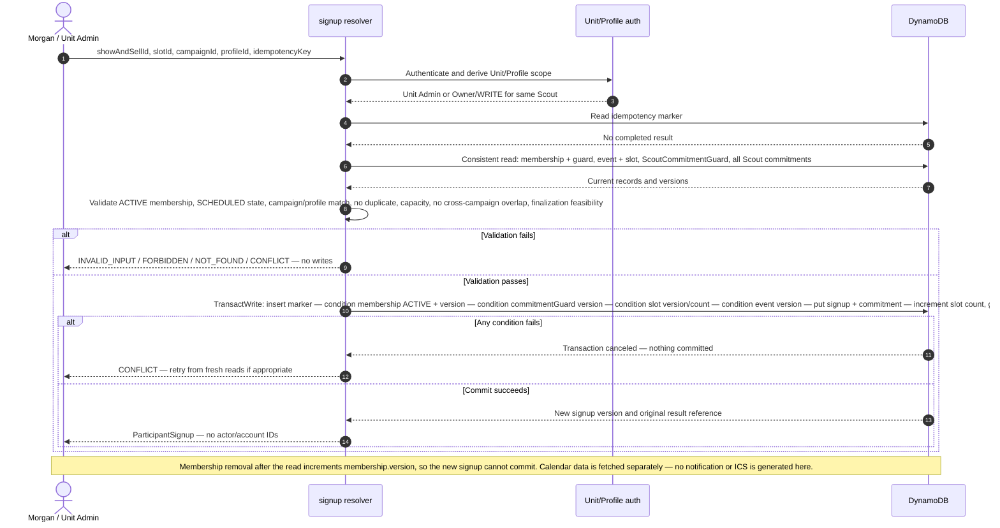
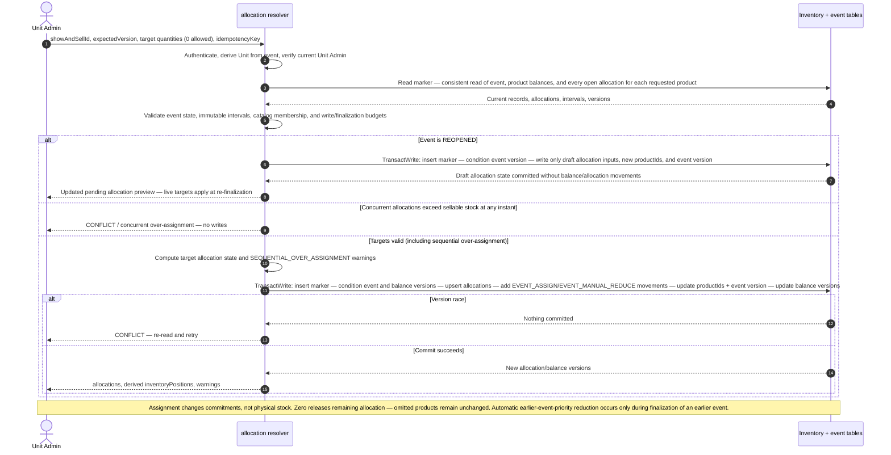
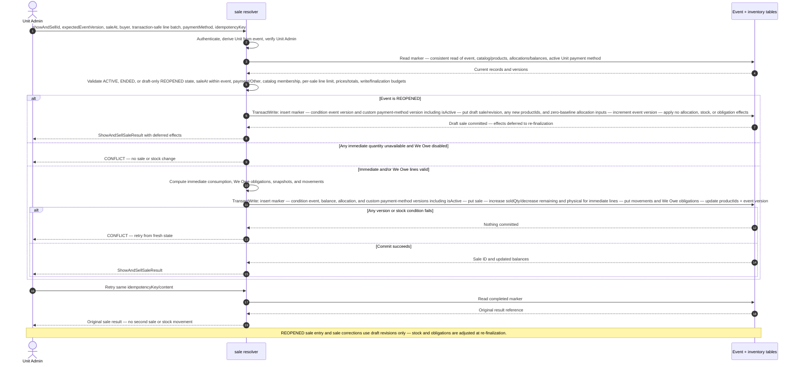
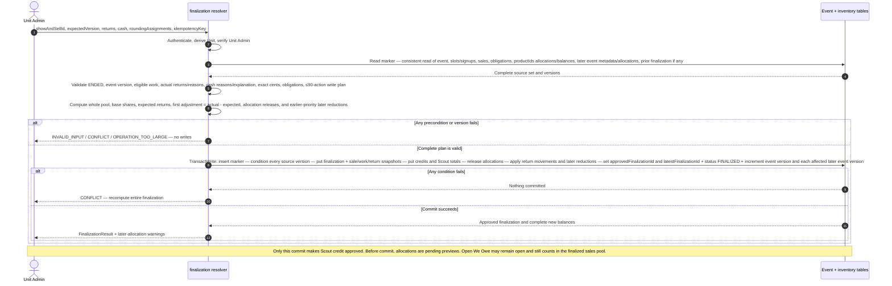
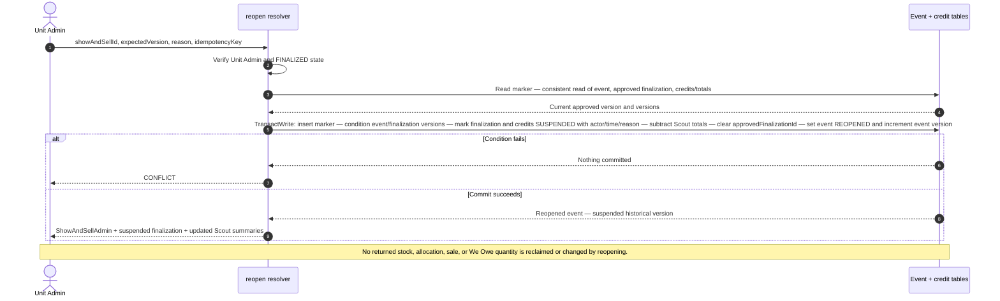
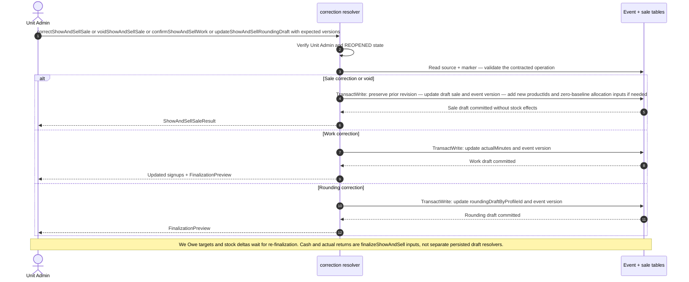
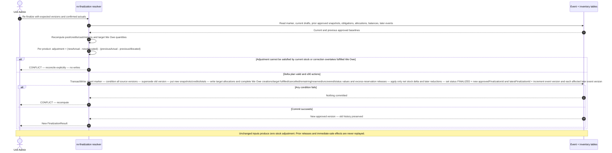
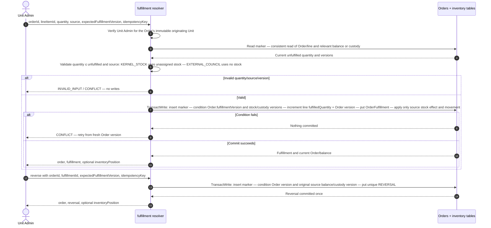
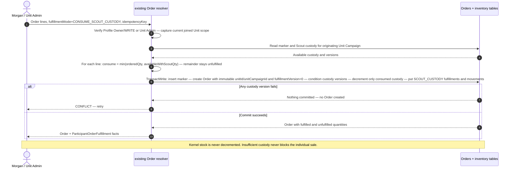

# Show & Sell and inventory transaction sequence diagrams

**Status:** Proposed implementation sequencing for the highest-risk workflows  
**Last updated:** 2026-10-30  
**Requirements:** [Show & Sell and inventory specification](SHOW_AND_SELL_INVENTORY_SPECIFICATION.md)  
**Data model:** [Show & Sell data model](SHOW_AND_SELL_DATA_MODEL.md)  
**API contract:** [Show & Sell GraphQL API](SHOW_AND_SELL_GRAPHQL_API.md)

## 1. Purpose

These diagrams specify actor order, authorization checks, authoritative reads, validations, version conditions, writes, retry behavior, and externally visible results for the workflows most likely to cause implementation rework.

They are design contracts, not resolver code. Names in diagrams refer to logical resolvers/models, not required class names.

## 2. Shared transaction contract

Every mutation follows this sequence unless its diagram explicitly says otherwise:

1. **Authenticate** the Cognito caller.
2. **Derive tenancy from the requested resource.** Client-supplied Unit/Campaign IDs are consistency checks, never authorization authorities.
3. **Authorize now** using the current Unit grant or SellerProfile access. Global application ADMIN and API-key access do not substitute.
4. **Read the idempotency marker** in the relevant aggregate table. Completed identical retries return the original result — same-key/different-fingerprint requests fail.
5. **Read authoritative records consistently**, including all versioned records whose state is validated.
6. **Validate current state and compute the complete write plan**, including the 90-action ceiling and finalization-feasibility preflight where applicable.
7. **Conditionally write in one DynamoDB transaction**: marker, business records, movements/snapshots, counters, and every checked version. Any failed condition writes nothing.
8. **Return only the authorized output projection.** Participant and Unit Admin projections differ by design.

A stale version returns `CONFLICT` — retry recomputes from a new consistent read rather than applying stale deltas. Retryable infrastructure contention returns `RESOURCE_BUSY`. No diagram uses a standalone idempotency/coordinator table or a multi-stage coordinator.

## 3. Signup: `signupScoutForShowAndSellSlot`



**Required proof cases:** successful Owner/WRITE and Unit Admin signup — READ denial — capacity race — cross-campaign conflict — duplicate retry — membership-removal race — finalization-budget preflight.

## 4. Inventory assignment: `assignShowAndSellInventory`



**Required proof cases:** overlapping 3+3 blocked on four units — sequential 3+3 warning — target zero — omitted product unchanged — concurrent writers cannot both succeed — a 16th distinct catalog product is allowed in a separate assignment and included in finalization.

## 5. Sale entry: `createShowAndSellSale`



**Required proof cases:** immediate sale — mixed immediate/We Owe — unavailable with We Owe off — Other details — inactive/wrong-Unit method — stale balance/event versions — duplicate retry — scheduled/finalized event denial.

## 6. First finalization: `finalizeShowAndSell`



**Required proof cases:** $60/360-minute split — Kernel-assigned cent — expected/actual return and cash mismatch explanations — automatic Afternoon reduction — stale source mutation during finalization — no partial credit on failure.

## 7. Reopen and re-finalization

### 7.1 Reopen: `reopenShowAndSell`



### 7.2 Draft corrections while reopened



### 7.3 Re-finalization



**Required proof cases:** credit suspended on reopen — no stock reclaimed — unchanged re-finalization has zero adjustment — added sale applies only delta — voided sale reverses only delta — We Owe cancellation releases only excess reservation — prior snapshots remain exact.

## 8. Individual and Scout-custody fulfillment

### 8.1 `fulfillIndividualOrderLine` and reversal



### 8.2 `createOrder(CONSUME_SCOUT_CUSTODY)`



**Required proof cases:** partial Kernel fulfillment — external fulfillment with no inventory row — stale external fulfillment race — one reversal only — door-to-door full/partial custody — origin scope retained after later roster join — idempotent retry.

## 9. Write-set accounting

Engineering must compute action counts from the actual write plan before every mutation — validation maxima are not independently composable.

| Operation | Writes included in the count |
| --- | --- |
| Signup | Idempotency marker, signup, commitment projection, slot counter, commitment guard, event version |
| Allocation | Marker, each allocation, each movement, each balance version, event/productIds/version |
| Sale | Marker, sale, per-product allocation/balance/movements, We Owe obligations, event/productIds/version |
| Finalization | Marker, event/status/version, finalization metadata, sale/work/return snapshots, credits, Scout totals, allocation releases, balances, movements, later reductions and affected later-event versions |
| Reopen | Marker, event, suspended finalization, suspended credits, Scout-total decrements |
| Re-finalization | Marker, event/version/status, old-version supersession, new finalization/snapshots/credits/totals, target allocations, complete We Owe creations/targets/releases, only delta movements, and affected later-event versions |
| Individual fulfillment | Marker, Order/version, fulfillment, source balance or custody when applicable, movement when applicable, deterministic reversal when applicable |

Example first-finalization action estimate:

```text
3 baseline writes (marker + event + finalization)
+ S sale snapshots
+ W work snapshots
+ 2C (credit + Scout-total projection per participant)
+ 4P (return snapshot + allocation + balance + movement per touched product)
+ 2L (allocation + movement per later-event reduction)
+ E (one metadata/version write per affected later event)
```

`L` is the number of later-event allocation reductions and `E` is the number of distinct later events affected. `P` includes every touched product, including products whose balances change only because of later-event reductions. The implementation must include every additional conditional check/write in its real count. If the complete operation exceeds 90, reject before writing and allow the Kernel to reduce participants/products/sales/later-event commitments. Source mutations must preflight finalization feasibility so they cannot knowingly create an event that is impossible to finalize within this budget.

## 10. Engineering validation requirements

Before expanding to the full feature, implement these diagrams as a vertical slice and prove:

1. Every read used for authorization or invariants is authoritative and every validated version is included in the transaction condition set.
2. No failure after validation can expose partial sales, stock, obligations, cash, credit, or finalization results.
3. Every retry either returns the original result or recomputes safely from new versions.
4. All six areas have concurrency tests, not only happy-path browser tests.
5. Write-plan tests cover 1-, 2-, 5-, and 15-line sales, the largest computed transaction-safe sale, oversized orders split into independently atomic sales, and the largest supported finalization/reopen combinations.
6. Browser reports consume committed data only and generate all report/CSV/XLSX/print/ICS output locally.

These diagrams are the reference for implementation review. Deviating from their authorization, version, delta, or visibility rules requires updating this document and the corresponding acceptance descriptions rather than silently choosing different behavior.
